<p align="center">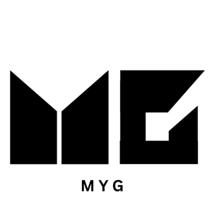</p>

<h1 align="center">MyG</h1>

<p align="center"><b>An iOS workout tracker with an AI coach, built for science-based lifters.</b></p>

MyG logs your sets, reps and weights, charts your progress per exercise, and gives you a personal AI coach that reads your actual training history before answering. Built in two people over NUS Orbital 2025 (CP2106), where it reached the **Apollo 11** tier, the second-highest level.

<p align="center">
  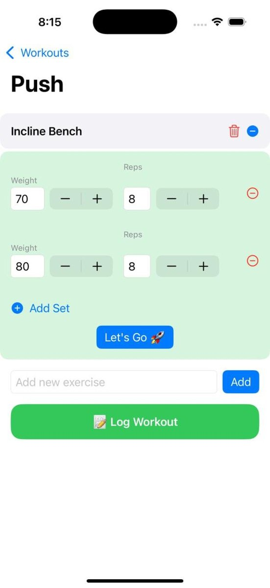
  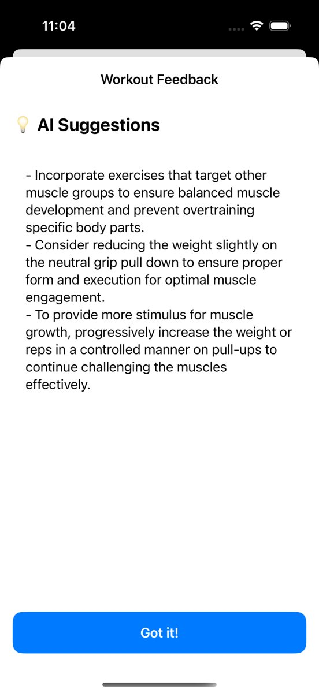
  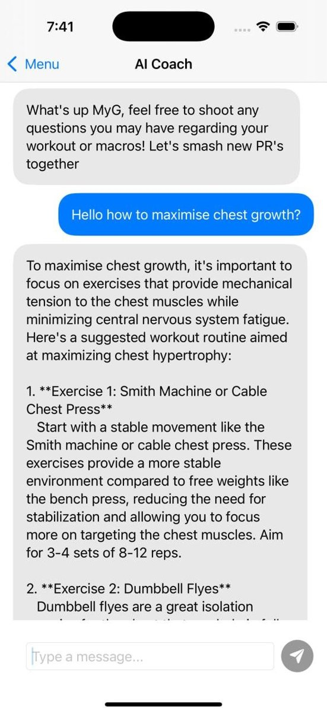
  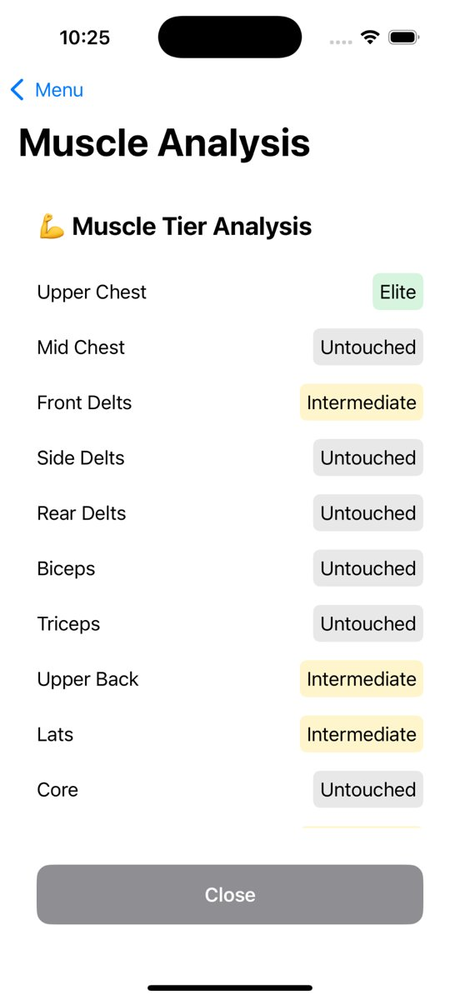
</p>

**Demo video:** [MyG walkthrough on YouTube](https://www.youtube.com/watch?v=Dw2wRHIpO8M)

## The problem

Science-based lifting, training for maximum muscle growth with progressive overload, careful exercise selection and controlled fatigue, has taken over gym culture. Most lifting apps only record numbers. They don't help you decide what to do next, and the advice online is scattered and contradictory, which is especially hard on beginners.

We wanted one app that keeps an accurate record of your training **and** turns that record into personalised, evidence-based advice while you're still at the gym.

## Features

| Feature | What it does |
|---|---|
| **Workout logger** | Start a session, add exercises with sets, reps and weights, and log it. Training volume is calculated automatically. |
| **Progress over time** | Charts the volume history for any exercise you've logged (Swift Charts). |
| **AI coach** | Chat with a coach that is given your 20 most recent workouts and your past questions as context, and answers with a hypertrophy-focused system prompt. Logging a workout also triggers automatic advice. |
| **Muscle tier analysis** | Ranks 12 muscle groups as Elite / Intermediate / Beginner / Untouched from your full workout history. |
| **Food macro scanner** | Snap a photo of your meal (optionally add a description) and a vision-capable LLM identifies the dish and estimates calories, protein, carbs and fat. |
| **Macro-friendly map** | Shows healthier eateries near you on a map, using Singapore Health Promotion Board data. |
| **Accounts** | Email/password signup and login with bcrypt-hashed passwords. |

<details>
<summary><b>More screenshots</b></summary>
<p align="center">
  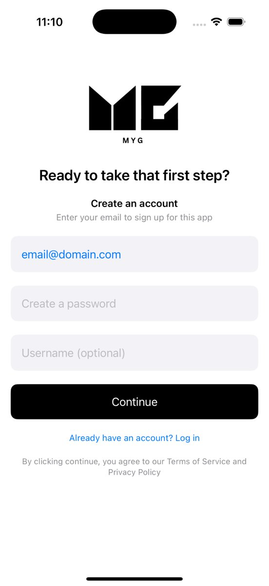
  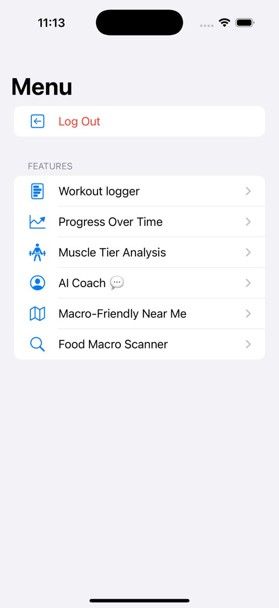
  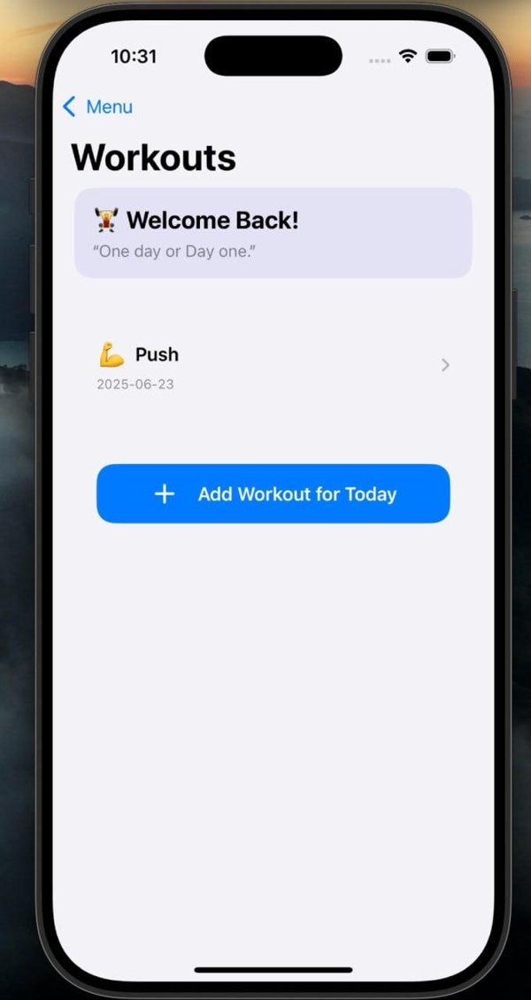
  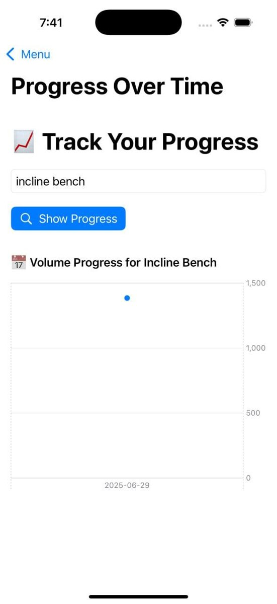
  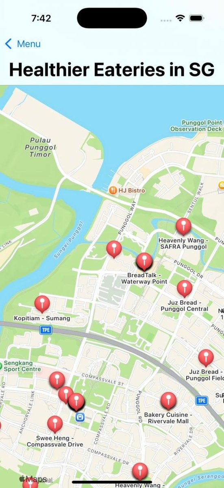
  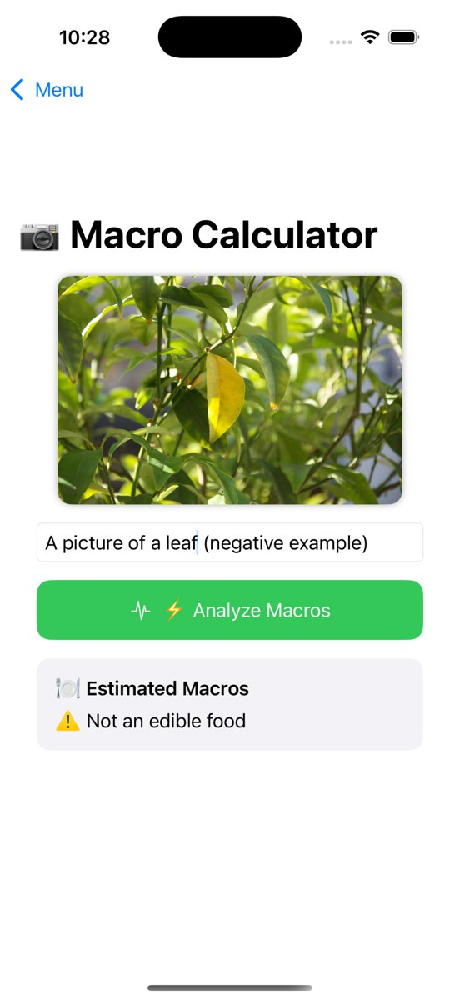
</p>
</details>

## User testing

We tested the finished app with 9 lifters, from beginners to experienced users, and collected feedback through a Google Form.

| Question | Result |
|---|---|
| Ease of navigation (1–5) | **All 9 rated 4 or 5** (56% gave 5) |
| Overall design and layout (1–5) | **All 9 rated 4 or 5** (67% gave 4, 33% gave 5) |
| Would use it regularly | **67% yes**, 33% maybe, 0% no |
| Response time | 44% satisfactory, 56% acceptable |

**What landed:** the AI features (post-workout suggestions, coach, muscle tiers) were the most-cited favourites, along with the progress tracker.
**What didn't:** the eateries map felt too lenient about what counts as "macro-friendly" and showed too many options, the muscle tier ratings were unclear to some users, and several people asked for Google login and a form checker.

## Architecture

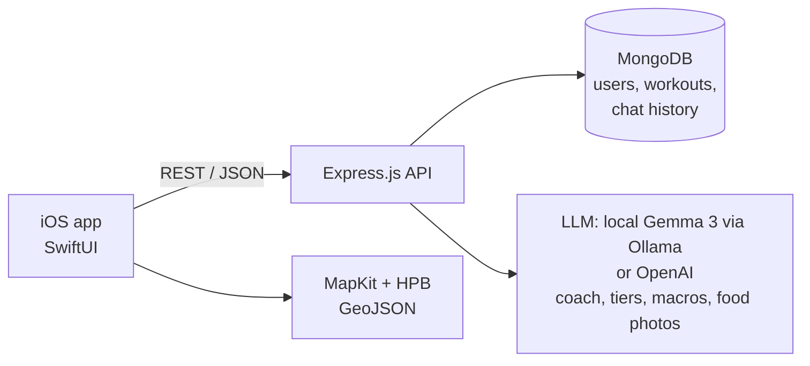

**Tech stack:** SwiftUI, Swift Charts, MapKit · Node.js, Express 5, Mongoose · MongoDB (Atlas or local) · LLM through the OpenAI-compatible API: free local Gemma 3 via Ollama by default, or OpenAI · Jest + Supertest.

```
ios/        SwiftUI app (open ios/MyG.xcodeproj)
backend/    Express API: routes/, models/, utils/, scripts/, test/
docs/       Setup guide
```

## Team and roles

| | Role | Owned |
|---|---|---|
| **Dylan Teo** ([@dylantjy](https://github.com/dylantjy)) | UI/UX design and iOS frontend | UI/UX: early Figma wireframes, then designed and iterated directly in SwiftUI. The entire iOS app: login/signup, workout logger, progress charts, AI coach chat, muscle tier view, food scanner, macro-friendly map. Shaped the AI coach's tone and its science-based coaching rules |
| **Alden Chua** ([@denz-denz](https://github.com/denz-denz)) | Backend | Express API, MongoDB models, auth, OpenAI and Vision integrations, Render deployment, Jest test suite |

We integrated and debugged the frontend and backend together.

## Running it

See [docs/SETUP.md](docs/SETUP.md). In short: install [Ollama](https://ollama.com) and run `ollama pull gemma3:4b`, run `npm install && npm start` in `backend/`, then build the iOS app in the Simulator. Everything runs locally and free: no API keys, and no database setup, because without a `MONGODB_URI` the backend runs a local MongoDB. Debug builds of the app talk to `http://localhost:3000`.

## Testing

- **Backend:** Jest + Supertest against an in-memory MongoDB (`mongodb-memory-server`), covering signup/login, the workout lifecycle (start → add exercise → log) and the AI routes.
- **iOS:** XCUITest UI tests generated with Cursor and run in Xcode, plus manual testing of each flow in the Simulator. The UI test target was not preserved in this repo.
- **Users:** Google Forms survey on usability, clarity, and the accuracy of macro estimates and AI suggestions.

## Known limitations

- After login the app identifies the user by a stored `userId`, and there are no session tokens yet, so the API trusts the client.
- Google Sign-In works in the backend, but it is disabled because shipping it in the iOS app needs a paid Apple Developer account. For the same reason the app isn't on the App Store.
- The original Render deployment is offline, so the app currently runs against a local backend.

## Since Orbital

While preparing this repo in 2026, I ([@dylantjy](https://github.com/dylantjy)) brought the project back to a runnable state on my own accounts:

- **Restored the iOS source.** It had ended up as an Xcode settings zip, so no Swift code was visible on `main`.
- **Self-contained backend:** it now runs locally with no database setup, and the server starts listening before the database connects, so it no longer hangs when MongoDB is unreachable.
- **Food scanner works end to end:** the app now uploads the photo, which it never did before (only the text description was sent). The backend sends the photo straight to the LLM, replacing Google Cloud Vision.
- **Free, local AI by default:** the backend talks to any OpenAI-compatible endpoint and defaults to the open-weights Gemma 3 model running on your own machine through Ollama, so no paid API key is needed. Set an OpenAI key to switch back.
- **More reliable AI output:** JSON mode for the muscle tiers and macro estimates (malformed JSON was our most common bug), and the coach now remembers its own replies as well as the user's questions.
- **Login errors are shown to the user** instead of being silently ignored, and there's a demo-data seed script.

## Reflections

This was our first full-stack project. We started out overscoped, with tiers, gamification, rest timers and RIR tracking, and learnt to cut down to an MVP that worked end to end. Most of our hardest problems were at the boundary between the app and the API: agreeing on request and response shapes, handling errors on the client, and keeping the app pointed at the right server.
