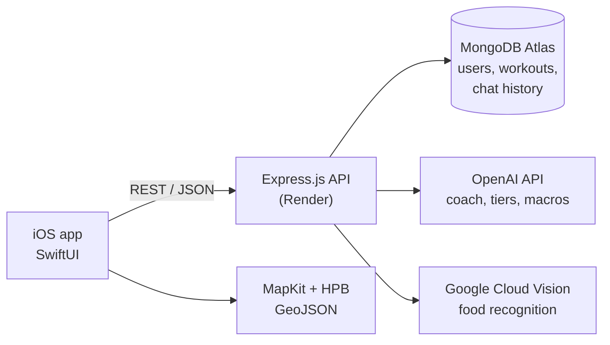

# MyG

**An iOS workout tracker with an AI coach, built for science-based lifters.**

MyG logs your sets, reps and weights, charts your progress per exercise, and gives you a personal AI coach that reads your actual training history before answering. Built in two people over NUS Orbital 2025 (CP2106), where it reached the **Apollo 11** tier, the second-highest level.

<!-- TODO: add screenshots / demo GIF here, e.g.
<p align="center">
  
  
  
  
</p>
-->

## The problem

Science-based lifting, training for maximum muscle growth with progressive overload, careful exercise selection and controlled fatigue, has taken over gym culture. Most lifting apps only record numbers. They don't help you decide what to do next, and the advice online is scattered and contradictory, which is especially hard on beginners.

We wanted one app that keeps an accurate record of your training **and** turns that record into personalised, evidence-based advice while you're still at the gym.

## Features

| Feature | What it does |
|---|---|
| **Workout logger** | Start a session, add exercises with sets, reps and weights, and log it. Training volume is calculated automatically. |
| **Progress over time** | Charts the volume history for any exercise you've logged (Swift Charts). |
| **AI coach** | Chat with a coach that is given your 20 most recent workouts and your past questions as context, and answers with a hypertrophy-focused system prompt. Logging a workout also triggers automatic advice. |
| **Muscle tier analysis** | Ranks 12 muscle groups as Elite / Intermediate / Beginner / Untouched from your full workout history. |
| **Food macro scanner** | Snap a photo of your meal: Google Cloud Vision identifies the food and the LLM estimates calories, protein, carbs and fat. |
| **Macro-friendly map** | Shows healthier eateries near you on a map, using Singapore Health Promotion Board data. |
| **Accounts** | Email/password signup and login with bcrypt-hashed passwords. |

## Architecture



**Tech stack:** SwiftUI, Swift Charts, MapKit · Node.js, Express 5, Mongoose · MongoDB Atlas · OpenAI API · Google Cloud Vision · Jest + Supertest · deployed on Render · designed in Figma.

```
ios/        SwiftUI app (open ios/MyG.xcodeproj)
backend/    Express API: routes/, models/, utils/, test/
docs/       Setup guide
```

## Team and roles

| | Role | Owned |
|---|---|---|
| **Dylan Teo** ([@dylantjy](https://github.com/dylantjy)) | UI/UX design and iOS frontend | Figma designs; the entire SwiftUI app: login/signup, workout logger, progress charts, AI coach chat, muscle tier view, food scanner, macro-friendly map; collaborated on prompt design for the AI coach |
| **Alden Chua** ([@denz-denz](https://github.com/denz-denz)) | Backend | Express API, MongoDB models, auth, OpenAI and Vision integrations, Render deployment, Jest test suite |

We integrated and debugged the frontend and backend together.

<!-- TODO: add Figma link, e.g. **Design:** [Figma file](https://www.figma.com/...) -->

## Running it

See [docs/SETUP.md](docs/SETUP.md). In short: open `ios/MyG.xcodeproj` in Xcode and run. The app talks to the deployed backend by default, and you can point it at your own by editing `ios/MyG/APIConfig.swift`.

## Testing

- **Backend:** Jest + Supertest against an in-memory MongoDB (`mongodb-memory-server`), covering signup/login, the workout lifecycle (start → add exercise → log) and the AI routes.
- **iOS:** manual testing of each flow in the Xcode Simulator and on device.
- **Users:** Google Forms survey on usability, clarity, and the accuracy of macro estimates and AI suggestions.

## Known limitations

- After login the app identifies the user by a stored `userId`, and there are no session tokens yet, so the API trusts the client.
- The Google Sign-In button is in the app, but the backend route is disabled.
- The AI coach stores the user's questions but not its own replies, so its conversation memory is one-sided.
- The backend runs on Render's free tier, so the first request after idle can take 30–60 s.

## Reflections

This was our first full-stack project. We started out overscoped, with tiers, gamification, rest timers and RIR tracking, and learnt to cut down to an MVP that worked end to end. Most of our hardest problems were at the boundary between the app and the API: agreeing on request and response shapes, handling errors on the client, and keeping the app pointed at the right server.
